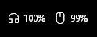

# taskbar-battery

**See the battery level of your wireless mouse, headset, earbuds, and keyboard right on the Windows 11 taskbar.** No need to open G HUB or Bluetooth settings.



- **Automatic:** detects Logitech wireless devices and Bluetooth devices on its own, with nothing to configure.
- **Lightweight:** a single ~300 KB executable written in Rust. It uses under 20 MB of RAM, has no installer or runtime dependencies, and sits idle between checks.
- **Accurate:** for Logitech devices that report a voltage, it uses G HUB's own battery curves (when G HUB is installed), so the percentages match what G HUB shows.
- **Native look:** follows the light/dark taskbar theme, scales with DPI, and uses Windows' own Fluent icons.
- **Private:** everything stays on your PC. There are no network requests, no telemetry, and no accounts.

---

## Contents

- [Supported devices](#supported-devices)
- [Install](#install)
- [Using it](#using-it)
- [How it works](#how-it-works)
- [Troubleshooting](#troubleshooting)
- [Limitations](#limitations)
- [Uninstall](#uninstall)
- [Build from source](#build-from-source)
- [Contributing](#contributing)
- [Credits](#credits)

---

## Supported devices

| Connection | Devices | How the battery is read |
|---|---|---|
| **Logitech receivers**: Lightspeed, Unifying, Bolt | Mice, keyboards, and anything else paired to the receiver | Logitech's HID++ protocol, over the receiver |
| **Logitech dongles** | Wireless headsets (e.g. PRO X Wireless, G series) | HID++, directly over the dongle |
| **Bluetooth LE** | Most Bluetooth mice, keyboards, and gamepads | Standard GATT Battery Service |
| **Classic Bluetooth** | Headphones and earbuds (AirPods, Galaxy Buds, Sony…) | The battery level the device reports to Windows, the same value Settings › Bluetooth shows |

### Tested on real hardware

| Device | Connection | Status |
|---|---|---|
| Logitech G Pro Wireless (mouse) | Lightspeed receiver | ✅ matches G HUB |
| Logitech PRO X Wireless (headset) | USB dongle | ✅ matches G HUB |
| Apple AirPods | Classic Bluetooth | ✅ |
| Bluetooth LE mouse/keyboard | Bluetooth LE | ⚠️ implemented, not yet tested on hardware |

Using a device that isn't listed? Please [open an issue](../../issues) saying whether it works, so it can be added to the table.

### Not supported (yet)

Razer, SteelSeries, Corsair, HyperX and other **2.4 GHz dongles** each use their own undocumented protocol. They will show up if they're connected over Bluetooth, but not through their USB dongles. See [Contributing](#contributing) if you want to add one.

---

## Install

1. Download **`taskbar-battery.exe`** from the [latest release](../../releases/latest).
2. Move it to a permanent folder. The recommended location is:
   ```
   %LOCALAPPDATA%\Programs\taskbar-battery\
   ```
   It registers itself to start with Windows from wherever it is, so don't run it from your Downloads folder.
3. Double-click it. The battery levels appear on the taskbar, to the left of the system tray.

> **Windows SmartScreen warning?** The exe isn't code-signed (certificates cost money), so on first run Windows may say *"Windows protected your PC"*. Click **More info → Run anyway**. You can also [build it from source](#build-from-source) yourself.

**Requirements:** Windows 11. Windows 10 may work but is untested. G HUB is optional.

---

## Using it

### Reading the widget

| What you see | Meaning |
|---|---|
| 🎧 `85%` | Battery level |
| White/black text | Normal. The color follows your taskbar theme |
| **Red** text | Battery at 15% or below |
| **Green** text | Charging (Logitech devices) |
| Device not shown | Not connected, or hidden in the menu |

Device types have their own icons: headset, earbuds, mouse, keyboard, gamepad, and a generic battery icon for anything else. Devices are shown in that order.

### Right-click menu

Right-click the widget to see:

- **Every detected device** with its current level, including disconnected ones. Uncheck a device to hide it from the taskbar, check it again to bring it back.
- **Refresh now:** checks all devices immediately.
- **Start with Windows:** turn launching at login on or off. It's on by default.
- **Exit**

### How often it updates

| Source | Interval |
|---|---|
| Logitech | every 15 s |
| Bluetooth | every 60 s (reading wakes the device's radio, so it's polled less often) |
| Any USB device plugged in or out | immediately |

### Sleeping devices

Logitech mice and keyboards go to sleep after a short idle period and stop answering. While asleep, the widget keeps showing the **last known level**, because the battery doesn't change while a device sleeps. It doesn't wake the device to check, since that would drain the battery you're trying to watch.

A device that's switched off looks the same to the receiver as one that's asleep, so it also keeps its last reading. A headset that's switched off is detected as off and removed from the bar.

---

## How it works

### The taskbar widget

Windows 11 has no public API for taskbar widgets: the old "desk band" API was removed. taskbar-battery creates a small transparent window and attaches it to the taskbar as a child window, placed just left of the notification area. Utilities like TrafficMonitor use the same technique.

- Text is drawn with per-pixel transparency, so it blends cleanly with the taskbar's background effects.
- If Explorer restarts (crash, or `taskkill /f /im explorer.exe`), the widget is recreated when the new taskbar appears.
- It follows DPI scaling and light/dark theme changes live.

### Logitech (HID++)

Logitech wireless devices speak **HID++**, a protocol tunneled through vendor-defined HID reports. taskbar-battery:

1. Finds every Logitech HID++ interface: receivers (up to 6 paired devices each) and direct dongles.
2. Asks each device which battery feature it supports:

   | Feature | Name | Returns |
   |---|---|---|
   | `0x1004` | Unified Battery | percentage + charging state |
   | `0x1000` | Battery Status | percentage + charging state |
   | `0x1001` | Battery Voltage | millivolts (most Lightspeed gaming mice) |
   | `0x1F20` | ADC Measurement | millivolts (headsets) |

3. Reads the device's name and type (`0x0005`) and its model IDs (`0x0003`).
4. For voltage-only devices, converts millivolts to a percentage. If G HUB is installed, it uses G HUB's per-device discharge curve from `C:\ProgramData\LGHUB\depots\…\*battery*.xml`, so the numbers match G HUB exactly. Otherwise it uses a generic Li-ion curve, which is usually within a few percent.

It works alongside G HUB: requests are tagged with their own software ID, so the two don't interfere. G HUB doesn't need to be running, or even installed.

### Bluetooth

- **Bluetooth LE:** reads the standard Battery Level characteristic (`0x2A19`) of the GATT Battery Service (`0x180F`) through the Windows Runtime Bluetooth APIs. Device type comes from the BLE Appearance value. Connected phones and computers are skipped.
- **Classic Bluetooth:** headphones report their battery to Windows over the Hands-Free profile, and Windows stores it as a device property (`{104EA319-6EE2-4701-BD47-8DDBF425BBE5} 2`). That's where Settings › Bluetooth gets it. taskbar-battery reads the same property and only shows devices that are currently connected.
- Earbuds and over-ear headphones are told apart by the BLE Appearance value when available, otherwise by name ("AirPods", "Buds", …).

### Footprint

| | |
|---|---|
| Executable | ~300 KB, no installer, no DLLs |
| Memory | under 20 MB |
| CPU | idle between checks. A Logitech scan takes well under a second |
| Disk / registry | only the settings listed under [Uninstall](#uninstall) |
| Network | none |

---

## Troubleshooting

**The widget doesn't appear.**
- It only shows when at least one device with a battery is connected. Right-click where it would be. If nothing's there, check that `taskbar-battery.exe` is running in Task Manager.
- Only the main taskbar is supported. Taskbars on secondary monitors aren't (yet).

**A Logitech device is missing.**
- Move or click it to wake it up. A device that's asleep when the app starts is discovered on the next check, within 15 s.
- Wired-only devices have no battery, so they're never shown.

**My Bluetooth device is missing.**
- Check that Windows itself shows its battery level in *Settings › Bluetooth & devices*. If Windows doesn't get it, the device probably doesn't report it.
- Bluetooth is checked every 60 s. Use *Refresh now* from the right-click menu to check immediately.

**The percentage differs from G HUB.**
- Install G HUB (it doesn't need to be running) so its battery curves are used. Without them a generic curve is used, which can be off by a few percent.
- G HUB also smooths readings over time, so the two can differ by about 1%.

**The widget overlaps something or is misplaced after a Windows update.**
- Windows updates can change the taskbar's internals. Please [open an issue](../../issues) with a screenshot and your Windows build (`winver`).

---

## Limitations

- Main taskbar only, and Windows 11 only (Windows 10 is untested).
- Placement relies on the taskbar's internal window layout, which isn't a public API. A future Windows update could break it.
- Charging state isn't available for Bluetooth devices, and charging percentages for Logitech voltage-based devices may not match G HUB, which uses separate charging curves.
- A Logitech device that's switched off keeps showing its last level, because it's indistinguishable from a sleeping one.
- A device that's asleep when the app starts isn't shown until it wakes.

---

## Uninstall

1. Right-click the widget → uncheck **Start with Windows** → **Exit**.
2. Delete `taskbar-battery.exe`.
3. Optionally, remove its settings with `reg delete HKCU\Software\taskbar-battery /f`.

Everything it writes:

| Location | Purpose |
|---|---|
| `HKCU\Software\Microsoft\Windows\CurrentVersion\Run` → `TaskbarBattery` | Start with Windows |
| `HKCU\Software\taskbar-battery` → `AutostartOptOut`, `Hidden` | Your menu choices |

---

## Build from source

Requirements: [Rust](https://rustup.rs) (stable) and the Visual Studio C++ Build Tools (MSVC).

```sh
git clone https://github.com/renanleonel/windows-taskbar-battery
cd windows-taskbar-battery
cargo build --release            # -> target/release/taskbar-battery.exe
```

Debug builds keep a console window and print diagnostics. They also don't register themselves to start with Windows.

```sh
cargo run                        # run the widget with logs
cargo run -- --once              # print detected devices and exit
cargo run -- --list              # list Logitech HID interfaces
```

Example `--once` output:

```
Headset    PRO X Wireless Gaming Headset        100%  [logi:0aba:3:ff]
Earbuds    Renan’s AirPods                      90%   [bt:f5cfd77bcb0b]
Mouse      G Pro Wireless Gaming Mouse          99%   [logi:c539:2:01]
```

### Project layout

```
src/
├── main.rs            entry point and debug commands
├── device.rs          device model; tracks devices across scans (sleep, disconnects)
├── logitech/
│   ├── mod.rs         device discovery, battery features, name/type
│   ├── hidpp.rs       HID++ transport (requests, replies, errors)
│   └── curve.rs       voltage → % (G HUB curves or generic)
├── bluetooth.rs       BLE battery service + classic Bluetooth battery property
├── widget.rs          taskbar window, menu, worker thread
├── render.rs          drawing (per-pixel alpha text and icons)
└── settings.rs        registry: start with Windows, hidden devices, theme
```

### Releases

Pushing a tag like `v0.2.0` makes GitHub Actions build the exe and publish it as a release.

---

## Contributing

Issues and PRs are welcome, especially:

- **Device reports:** tell us what works and what doesn't. Include the output of `cargo run -- --once` if you can.
- **New brands:** add a module next to `logitech/` and `bluetooth.rs` that returns a list of `device::Observation`s. [HeadsetControl](https://github.com/Sapd/HeadsetControl) and [OpenRazer](https://github.com/openrazer/openrazer) document many headset and Razer protocols.
- **Multi-monitor taskbars**, Windows 10 testing, and translations.

Please run `cargo clippy -- -D warnings` before opening a PR. CI runs it too.

---

## Credits

- [Wireless-Device-Battery-Monitor](https://github.com/krisgfx9/Wireless-Device-Battery-Monitor) by krisgfx9: the original inspiration for this project, and a much broader tool (C++, dozens of brands). If your device isn't supported here, try it.
- [Solaar](https://github.com/pwr-Solaar/Solaar): the reference for Logitech's HID++ protocol.
- [HeadsetControl](https://github.com/Sapd/HeadsetControl): headset protocol research.
- [TrafficMonitor](https://github.com/zhongyang219/TrafficMonitor): inspiration for the taskbar placement technique.

This project isn't affiliated with or endorsed by Logitech, Apple, or Microsoft. All trademarks belong to their owners.

## License

[MIT](LICENSE) © 2026 Renan Leonel
